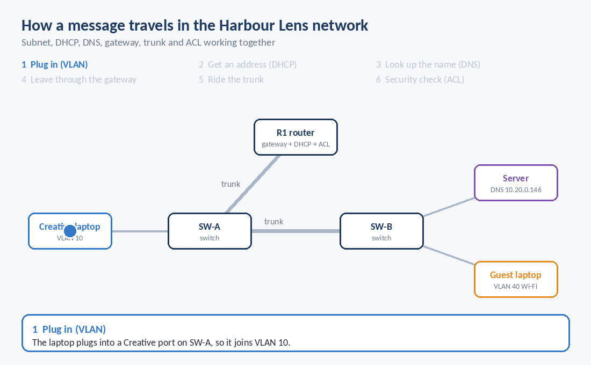
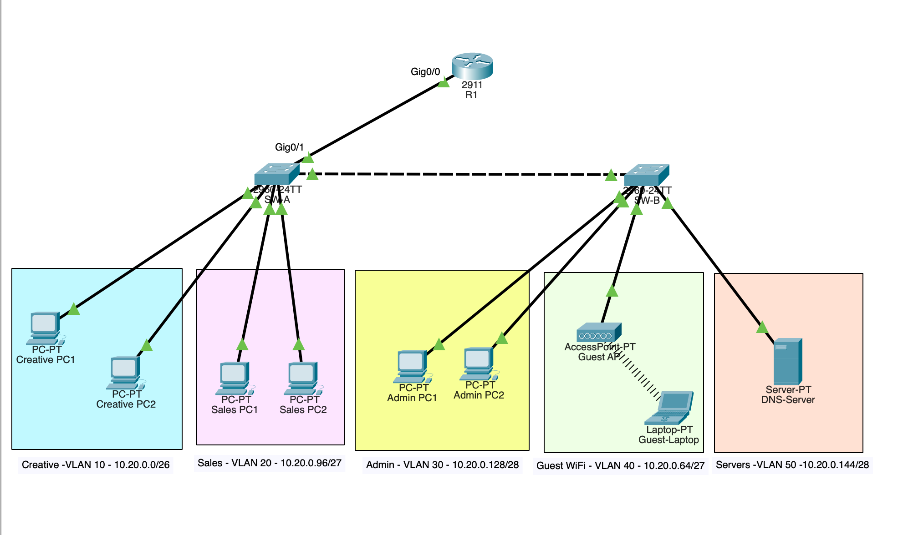

# Harbour Lens Studio – Small Office Network

A working network for a fictional photography studio in Sydney, built in **Cisco Packet Tracer**.
It splits the office into five VLANs, routes between them with a single router, hands out addresses
automatically with DHCP, resolves internal names with DNS, and keeps guest Wi-Fi away from staff
systems with an access control list.



## What this project shows

- VLSM subnetting of one /24 into five right-sized subnets, with 10% growth
- VLANs and 802.1Q trunks on Cisco 2960 switches
- Inter-VLAN routing with router-on-a-stick (sub-interfaces on a Cisco 2911)
- DHCP pools per VLAN, with gateways excluded
- An internal DNS server with an A record
- WPA2-secured guest Wi-Fi on its own VLAN
- An extended ACL that blocks guests from internal subnets but still allows DNS
- Testing and troubleshooting from the CLI

## Topology



- **R1** connects to **SW-A** over one trunk. R1 has one sub-interface per VLAN.
- **SW-A** (Building A) and **SW-B** (Building B) are joined by a second trunk.
- A full design write-up is in [docs/proposal.pdf](docs/proposal.pdf).

## IP addressing plan

Address block: `10.20.0.0/24` (private range). Subnets are placed largest first.
Each subnet's size allows for 10% growth plus three reserved addresses
(network address, gateway and broadcast).

| VLAN | Department | Subnet | Mask | Gateway | Device range |
|---|---|---|---|---|---|
| 10 | Creative | 10.20.0.0/26 | 255.255.255.192 | 10.20.0.1 | .2 – .62 |
| 40 | Guest Wi-Fi | 10.20.0.64/27 | 255.255.255.224 | 10.20.0.65 | .66 – .94 |
| 20 | Sales | 10.20.0.96/27 | 255.255.255.224 | 10.20.0.97 | .98 – .126 |
| 30 | Admin | 10.20.0.128/28 | 255.255.255.240 | 10.20.0.129 | .130 – .142 |
| 50 | Servers | 10.20.0.144/28 | 255.255.255.240 | 10.20.0.145 | .146 – .158 |

`10.20.0.160 – 10.20.0.255` is kept free for future departments.
The DNS server has a static address, `10.20.0.146`, so every device can always find it.

## Guest access control

The ACL `GUEST-BLOCK` is applied inbound on R1's guest sub-interface (`Gi0/0.40`).
Rules are checked from top to bottom:

```
permit udp 10.20.0.64 0.0.0.31 host 10.20.0.146 eq domain   ! guests may use DNS
deny   ip  10.20.0.64 0.0.0.31 10.20.0.0 0.0.0.255          ! guests may not reach staff subnets
permit ip  any any                                          ! everything else (future internet access)
```

## Test results

| # | Test | Result | Evidence |
|---|---|---|---|
| 1 | Every device receives an address by DHCP | ✅ Each VLAN's devices got addresses from the right pool | [bindings](screenshots/test-dhcp-bindings.png) |
| 2 | Creative pings Sales (another VLAN) | ✅ Replies with TTL=127, which shows the traffic was routed through R1 | [ping](screenshots/test-inter-vlan-ping.png) |
| 3 | Staff PC pings `files.harbourlens.local` | ✅ Name resolved to 10.20.0.146 and replied; the server's web page also loaded | [ping](screenshots/test-dns-ping.png), [web page](screenshots/test-dns-web.png) |
| 4 | Guest laptop joins Wi-Fi with WPA2 | ✅ Received 10.20.0.67 from the guest pool | [bindings](screenshots/test-dhcp-bindings.png) |
| 5 | Guest laptop pings the server (10.20.0.146) | ✅ Blocked: "Destination host unreachable" from the guest gateway | [blocked](screenshots/test-guest-blocked.png), [ACL matches](screenshots/test-acl-matches.png) |

## Problems I hit and how I fixed them

**Planning the subnets**
- My first IP plan had the block boundaries wrong. I gave Sales the range .65 to .95 and used .96 as
  its broadcast, when a /27 that starts at 64 actually ends at 95. I also started Admin at .131 because
  I added the 3 reserved addresses to the starting point instead of counting them inside the block.
  I fixed this by using one rule for every subnet: the network address is the start, the gateway is
  start + 1, and the broadcast is start + size − 1. The next subnet begins right after that.
- I first wanted to give Sales a /25. The maths worked, but it would have used 128 addresses for
  23 devices and left no room for new departments. I learned to choose the smallest subnet that fits
  after adding growth.

**Building the topology**
- I first connected the router to both switches, and I used the automatic cable tool, which picked
  random ports. Neither matched my port plan, so the configuration would not have lined up later.
  I rewired it as one trunk from R1 to SW-A and one from SW-A to SW-B, using straight-through and
  cross-over cables on the exact ports in my plan.
- I connected the guest laptop to a switch with a cable, but guests are meant to use Wi-Fi.
  I removed the cable, swapped the laptop's network card for a wireless card, and connected it to the
  access point with WPA2.

**Configuring the devices**
- A typo in `show vlan brief` gave an "invalid input" error, and typing `end` when I was already out of
  configuration mode froze the CLI. IOS was treating the unknown word as a hostname and trying to look
  it up with DNS. I added `no ip domain-lookup` to stop the freeze.
- I misspelled VLAN 50's name as "Severs" on SW-B and corrected it with `vlan 50` and `name Servers`.
- When I set up router-on-a-stick, I typed the settings for VLANs 30, 40 and 50 while still inside
  `Gi0/0.20`, so each one replaced the last. Sales lost its gateway. I fixed it by entering each
  sub-interface with its own `interface` command and checked the result with `show ip interface brief`.

**Testing**
- The first ping between VLANs timed out before the replies came through. This is normal: the devices
  first have to learn each other's hardware addresses (ARP).
- The guest laptop received .67 instead of .66. I checked `show ip dhcp binding` and
  `show ip dhcp conflict` and found no conflict. DHCP gives out a free address from the pool, not
  always the lowest one, so this was not a fault.

## Future improvements

- Limit each trunk to the VLANs it needs (`switchport trunk allowed vlan 10,20,30,40,50`)
- Secure device access: an `enable secret`, local users, SSH instead of open VTY lines, and password encryption
- Add internet access with NAT on R1
- Port security on access ports and shutting down unused ports
- Redundancy: a second uplink and a layer-3 switch instead of router-on-a-stick

## Files

```
configs/       Running configs for R1, SW-A and SW-B
docs/          Design proposal and traffic-flow animation
screenshots/   Topology and test evidence
HarbourLens-Network.pkt   Packet Tracer file
```

## Built with

Cisco Packet Tracer · Cisco IOS · Cisco 2911 router · Cisco 2960 switches

